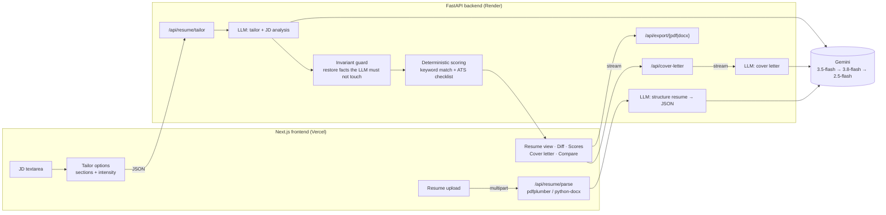

# Resume Customizer

Paste a job description, upload your resume (PDF or DOCX), and get back a version tailored to that job. The summary is rewritten, the most relevant bullets come first, and the JD's terminology is used, without inventing experience. You also get a keyword-match and ATS score, a diff of every change, gap suggestions, a streamed cover letter, and PDF / DOCX / TXT downloads.

- **Live app:** _<add Vercel URL>_
- **API:** _<add Render URL>_ (`/api/health`, interactive docs at `/docs`)

> No resume handy? Click **"Try it with a sample JD + resume"** at the top of the form.

---

## Features

| Requirement | Implementation |
| --- | --- |
| JD input + validation | Textarea with live character count. Must be non-empty, ≥ 100 and ≤ 20,000 characters. Enforced on both client and server. |
| Resume upload | Drag & drop or browse. PDF and DOCX. Shows the file name and size. Type, size (5 MB) and empty-file checks run on both client and server, plus magic-byte validation on the server. |
| Parsing | `pdfplumber` (PDF) and `python-docx` (DOCX, including tables and headers). The text is then structured into sections by the LLM. |
| LLM customization | Rewrites the summary, reorders and rephrases bullets, highlights matching skills and suggests missing keywords. Uses Gemini structured JSON output. |
| Output + download | Rendered resume with JD keywords highlighted. Download as **PDF** or **DOCX** (generated server-side, ATS-friendly single column) or **TXT**. |
| Error handling | Friendly messages for bad file type/size, empty input, corrupted or scanned PDFs, LLM rate limits/overload/timeouts, and the backend being unreachable. |

**Bonus features implemented**

- ✅ **Match score:** deterministic keyword coverage, before → after.
- ✅ **ATS score:** a transparent 100-point checklist (keywords, contact info, summary length, skills, standard sections, action verbs, quantified bullets, bullet length).
- ✅ **Diff view:** word-level diff per section. Heavily rewritten sections switch to a Before/After view.
- ✅ **Multiple versions:** generate as many versions as you like (different intensity or sections) and compare any two side by side.
- ✅ **Section-wise customization:** choose Summary / Skills / Experience / Projects, plus editing intensity (Light / Balanced / Bold).
- ✅ **Cover letter generator:** three tones.
- ✅ **Streaming:** the cover letter streams token-by-token into the UI.
- ✅ Session persistence: your JD, parsed resume, versions and cover letters survive a refresh (localStorage).
- ❌ Authentication: skipped to keep the app stateless (see trade-offs).

## Tech stack

| Layer | Tech |
| --- | --- |
| Frontend | Next.js 15 (App Router), React 19, TypeScript, Tailwind CSS v4, `lucide-react`, `diff` |
| Backend | Python 3.12, FastAPI, Pydantic v2, pdfplumber, python-docx, fpdf2 |
| LLM | Google Gemini via the official `google-genai` SDK |
| Hosting | Vercel (frontend), Render (backend, Docker) |
| Tests | pytest (backend: parsing, scoring, API, LLM fallback; 34 tests) |

### LLM provider and model

**Google Gemini (Google AI Studio API).** The primary model is **`gemini-3.5-flash`**, with automatic fallback to **`gemini-3.8-flash`** and then **`gemini-2.5-flash`**. All three are configurable with environment variables.

Why Flash models: tailoring is a structured rewrite task, not deep reasoning. Flash models give high-quality output in roughly 10–30 s on the free tier. The fallback chain exists because free-tier models regularly return `503 overloaded`. When that happens, the request moves to the next model instead of failing.

## Architecture



**Request flow**

1. **Upload → `/api/resume/parse`.** The file is validated (extension, size, magic bytes) and its text extracted. The LLM converts the raw text into a typed `Resume` (name, contact, summary, skill groups, experience, projects, education, extra sections) at temperature 0, copying content verbatim. The UI shows "Parsed N roles, M skills" as confirmation.
2. **Tailor → `/api/resume/tailor`.** The structured resume and JD go to the tailoring prompt, which returns a `TailorOutput` (tailored resume, JD keywords, matched skills, missing keywords with suggestions, change log). Then:
   - **Invariant guard:** name, contact, education, extra sections, and every job's title/company/dates/location are restored from the original. Sections the user didn't select are restored too. If the model dropped or added a role, experience falls back to the original. Even if the model misbehaves, these facts can't change.
   - **Scoring:** keyword coverage and the ATS checklist are computed deterministically for the original and tailored resume, using the same keyword list. Later versions for the same JD reuse the first version's keyword list, so scores are comparable across versions.
3. **Cover letter → `/api/cover-letter`.** Streamed as `text/plain` chunks. The backend reads the first chunk before sending the 200, so auth/quota errors still arrive as proper HTTP errors.
4. **Export → `/api/export/{pdf|docx}`.** Renders the structured resume into a clean single-column document (no tables or columns, so ATS parsers read it correctly).

The backend is stateless. Nothing is written to disk or stored, and resumes exist only for the duration of a request.

### Project structure

```
backend/
  app/
    main.py        # FastAPI routes, error handlers, rate limit, invariant guard
    llm.py         # Gemini client, structured output, retries + model fallback, streaming
    prompts.py     # all prompt templates (parse / tailor / cover letter)
    schemas.py     # Pydantic models: LLM response schemas + API contracts
    parsing.py     # PDF / DOCX text extraction and normalisation
    scoring.py     # keyword match + ATS checklist + resume → text
    export.py      # DOCX (python-docx) and PDF (fpdf2) renderers
    config.py      # env-based settings
  tests/           # pytest suite (LLM stubbed → runs offline)
  Dockerfile
frontend/
  src/app/page.tsx           # page state & layout
  src/components/            # JD input, upload, options, resume view, diff, insights, cover letter, compare
  src/lib/api.ts             # typed API client + streaming reader
samples/                     # sample JD + resume used by "Try it with a sample"
render.yaml                  # Render blueprint for the backend
```

## Prompt engineering

All prompts live in [`backend/app/prompts.py`](backend/app/prompts.py). The key decisions:

- **Truthfulness first.** The system prompt's first section is a set of non-negotiable rules: no invented employers, tools, metrics or achievements, every number kept exactly, and no inflated ownership ("helped" never becomes "led", "made" never becomes "architected"). It also forbids adding outcomes the original doesn't state and changing what a tool was used for. Real gaps go into `missing_keywords` with honest suggestions instead of into the resume. The backend's invariant guard enforces the hard facts in code as well.
- **Two-step pipeline (structure, then tailor).** Parsing into a typed schema first gives the tailoring step clean input and makes section-wise customization and the diff view possible. It also lets the backend verify what changed.
- **Structured output.** Gemini's `response_schema` (generated from Pydantic models) removes JSON-format instructions from the prompt and parsing failures from the code. Fields have no defaults, so the model must emit a complete shape.
- **Concrete per-section rules.** Summary: 2–4 sentences, ≤ 70 words, no first person or clichés. Bullets: action verb, then what, then how, then impact; 15–30 words. Skills: only evidenced skills, JD-relevant first, the JD's canonical spelling. Tense rules for current vs past roles.
- **Intensity levels.** Light, Balanced and Bold each change both the instructions and the temperature (0.2 / 0.4 / 0.7).
- **Prompt-injection hardening.** The JD and resume are wrapped in `<job_description>` and `<resume_json>` tags, and the model is told to treat their content as data, never instructions.
- **Iterated against real output.** Early runs showed small overclaims: "Made" became "Architected", Redis-for-background-jobs became "caching", and unstated benefits like "improving scalability" were added. The truthfulness rules were tightened to name these patterns explicitly.

## Running locally

**Prerequisites:** Python 3.11+, Node 20+, and a free Gemini API key from [Google AI Studio](https://aistudio.google.com/apikey).

### Backend

```bash
cd backend
python -m venv .venv
source .venv/bin/activate            # Windows: .venv\Scripts\activate
pip install -r requirements-dev.txt
cp .env.example .env                 # then put your GEMINI_API_KEY in .env
uvicorn app.main:app --reload --port 8000
```

API docs: http://localhost:8000/docs. Run the tests with `pytest`. They stub the LLM, so they need no key or network.

### Frontend

```bash
cd frontend
npm install
cp .env.example .env.local           # NEXT_PUBLIC_API_URL=http://localhost:8000
npm run dev
```

Open http://localhost:3000.

### Environment variables

| Variable | Where | Default | Purpose |
| --- | --- | --- | --- |
| `GEMINI_API_KEY` | backend | – | **Required.** Google AI Studio key |
| `GEMINI_MODEL` | backend | `gemini-3.5-flash` | Primary model |
| `GEMINI_FALLBACK_MODELS` | backend | `gemini-3.8-flash,gemini-2.5-flash` | Tried in order on 429/503 |
| `ALLOWED_ORIGINS` | backend | `http://localhost:3000` | CORS allow-list (comma-separated) |
| `ALLOWED_ORIGIN_REGEX` | backend | – | Optional, e.g. for Vercel preview URLs |
| `MAX_UPLOAD_MB` | backend | `5` | Upload size limit |
| `RATE_LIMIT_PER_HOUR` | backend | `60` | Per-IP limit on LLM endpoints |
| `LLM_TIMEOUT_SECONDS` | backend | `120` | Per-request LLM timeout |
| `NEXT_PUBLIC_API_URL` | frontend | `http://localhost:8000` | Backend base URL |

## Deployment

- **Backend → Render:** New → Blueprint → select this repo (it uses `render.yaml`, Docker, root `backend/`). Set `GEMINI_API_KEY`, and set `ALLOWED_ORIGINS` to the Vercel URL. Any Docker host works the same way, e.g. Cloud Run or Railway, since the container listens on `$PORT`.
- **Frontend → Vercel:** import the repo, set **Root Directory** = `frontend`, and add `NEXT_PUBLIC_API_URL` = the Render URL.

## Known limitations and trade-offs

- **Scanned/image-only PDFs aren't supported** (no OCR). The user gets a clear message asking for a text-based PDF or DOCX. Legacy `.doc` is rejected with a "save as .docx" hint.
- **The parse step uses an LLM call.** This is slower than pure heuristics (~5–10 s), but it handles the wide variety of resume layouts (multi-column, tables) far better. It also gives the structure that powers the diff and section-wise editing.
- **Keyword match is literal** (with normalisation for plurals, `.js`, `CI/CD`, acronyms in parentheses, etc.). It won't credit synonyms. That is intentional, because it mirrors how many ATS systems match, and the number stays reproducible rather than LLM-estimated.
- **The ATS score is a heuristic checklist**, not a replica of any vendor's ATS. Every point is explained in the UI.
- **PDF export uses built-in Latin-1 fonts** (fpdf2 core fonts), so non-Latin scripts (e.g. Devanagari, CJK) are stripped from the PDF. DOCX and TXT exports keep full Unicode. A bundled Unicode TTF would fix this at the cost of image size.
- **No authentication or server-side history.** Versions and cover letters persist in the browser (localStorage) instead. That keeps the backend stateless and free of PII, but history doesn't follow you across devices.
- **The rate limiter is in-memory** and per instance. That's fine for a single free-tier instance; Redis would be needed at scale.
- **Free-tier cold starts:** Render's free plan sleeps when idle, so the first request after a while can take ~30–50 s. The UI explains this if the server can't be reached.
- **LLM latency:** tailoring takes ~15–40 s depending on model load. The UI shows staged progress, and the cover letter is streamed.
